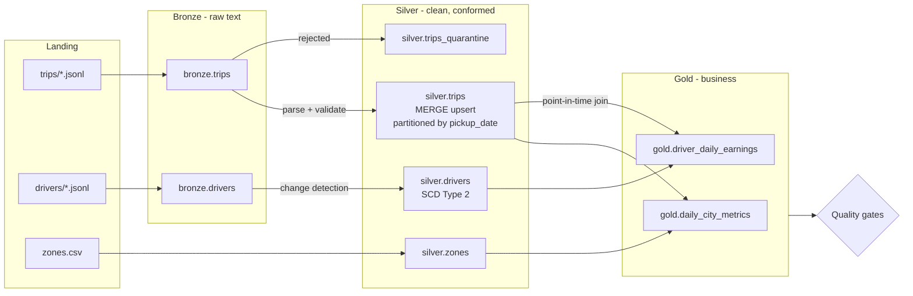

# Spark + Delta Lake Medallion Lakehouse

[](https://github.com/kaajjalchoudhary/spark-delta-lakehouse/actions/workflows/ci.yml)


A batch lakehouse for a ride-hailing platform, built with **PySpark** and **Delta Lake** in the
bronze / silver / gold (medallion) pattern. It processes one day at a time like a scheduled
production job, and every step is safe to re-run.

The feed is deliberately hostile, because real feeds are: events arrive a day late, fares are
adjusted the next day, lines are delivered twice, an upstream error page ends up in the file,
some trips break business rules, and the producer starts sending fields nobody told you about.

## What it demonstrates

| Technique | Where |
|---|---|
| Medallion architecture with raw-text bronze for replayability | [`bronze.py`](lakehouse/bronze.py) |
| Idempotent writes with Delta `replaceWhere` (re-run any day safely) | [`delta_io.py`](lakehouse/delta_io.py) |
| `MERGE` upserts with "latest event wins" and partition pruning | [`silver.py`](lakehouse/silver.py) |
| Quarantine table with a reason for every rejected line | [`silver.py`](lakehouse/silver.py) |
| Schema contract with drift detection (`json_object_keys`) | [`contracts.py`](lakehouse/contracts.py) |
| Generic **SCD Type 2** in a single atomic MERGE | [`scd2.py`](lakehouse/scd2.py) |
| **Point-in-time join** of facts to dimension history | [`gold.py`](lakehouse/gold.py) |
| Incremental gold: only the dates a batch touched are rebuilt | [`gold.py`](lakehouse/gold.py) |
| Quality gates that stop the run (reconciliation, uniqueness, SCD2 integrity) | [`quality.py`](lakehouse/quality.py) |
| `OPTIMIZE`, `ZORDER BY` and `VACUUM`; time travel in tests | [`maintenance.py`](lakehouse/maintenance.py) |
| Change Data Feed so consumers read only inserted and updated trips | [`changes.py`](lakehouse/changes.py) |
| A JSON run record per batch for observability | `lake/_runs/<date>.json` |

## Architecture



## Quick start

Requires Python 3.10+ and Java 11 or 17 (Spark runs locally, no cluster needed).

```bash
git clone https://github.com/kaajjalchoudhary/spark-delta-lakehouse.git
cd spark-delta-lakehouse
python -m venv .venv && source .venv/bin/activate
make install

make run                        # 14 days of landing files, processed day by day
make reprocess DATE=2026-01-05  # re-run one day: nothing changes
make maintain                   # OPTIMIZE / Z-ORDER / VACUUM
make report                     # gold totals, quarantine, drift, table versions
python -m lakehouse changes --since 1   # Change Data Feed: inserts and updates per commit
make test
```

With Docker (Java included):

```bash
docker build -t lakehouse .
docker run --rm -v "$PWD/lake:/data/lake" lakehouse
```

## Sample output

From a CI run over 14 days of generated data. Every CI run publishes this report on its
[run summary page](https://github.com/kaajjalchoudhary/spark-delta-lakehouse/actions/workflows/ci.yml).

```
Totals by city (gold.daily_city_metrics)
  city    currency  trips  cancel_rate  gross_fares  tips     avg_p50_min
  Dubai   AED       459    0.068        12624.4      634.0    19.5
  London  GBP       1474   0.083        22560.4      988.0    19.2
  Mumbai  INR       1492   0.076        237291.4     17910.0  19.3

Quarantined lines (silver.trips_quarantine)
  reason                               count
  dropoff_before_pickup                19
  malformed_or_missing_required_field  7
  negative_fare                        22

Undeclared fields seen in the trip feed: ['surge_multiplier']
```

Each batch also writes a run record (excerpt):

```json
{
  "batch_date": "2026-01-14",
  "seconds": 9.0,
  "drivers": {"changes_in_batch": 6, "new_versions": 5},
  "trips": {
    "events": 258, "valid": 253, "quarantined": 5, "upserted_trips": 246,
    "affected_dates": ["2026-01-13", "2026-01-14"],
    "unexpected_fields": ["surge_multiplier"]
  }
}
```

Six driver events produced five new versions because one was a re-send with nothing changed,
and the batch for the 14th also rebuilt gold for the 13th because late events arrived.

## How each layer works

### Bronze: keep exactly what arrived

Each landing file is stored as one row per line (`raw` text) with `_source_file`,
`_ingested_at` and `_batch_date`. Nothing is parsed, so a parsing bug or a contract change is
fixed by replaying bronze, not by asking the source to resend. Each batch overwrites only its
own `_batch_date` partition with `replaceWhere`, which makes re-runs and backfills idempotent.

### Silver: one trustworthy row per entity

**Trips.** Lines are parsed against an explicit contract. Anything unparseable or breaking a
rule (negative fare, drop-off before pick-up, unknown status) goes to `silver.trips_quarantine`
with the reason and the original text. Valid events are reduced to the latest per `trip_id` and
upserted with `MERGE`:

```python
target.merge(latest, "t.pickup_date IN (<batch dates>) AND t.trip_id = s.trip_id")
      .whenMatchedUpdateAll(condition="s.event_ts > t.event_ts")   # stale events never win
      .whenNotMatchedInsertAll()
```

That one statement handles late arrivals, next-day fare adjustments and duplicate deliveries,
and the `pickup_date` predicate lets Delta skip every partition the batch did not touch.

**Schema drift.** The pipeline compares the JSON keys actually received with the contract. When
the producer started sending `surge_multiplier`, the run logged a warning and recorded it in the
run file instead of silently dropping it. (`tip_amount` was added to the contract when it
appeared, and is NULL for older trips.)

**Drivers (SCD Type 2).** `merge_scd2` is a reusable function: give it a change feed, a key and
the tracked columns. It skips changes already applied (so re-runs are safe), ignores re-sent
records whose tracked attributes did not change, keeps several changes in one batch as separate
versions, and then closes old versions and inserts new ones in a **single atomic MERGE** using
the staged-updates pattern.

### Gold: answers for the business

- `daily_city_metrics`: trips, cancellation rate, gross fares, tips, median and p90 trip
  duration, and active drivers per city per day.
- `driver_daily_earnings`: earnings after the platform commission. Each trip is joined to the
  driver's attributes **as they were at pick-up time**, so a driver who switched from economy to
  comfort at noon has their morning trips counted as economy.

Gold is rebuilt only for the pick-up dates a batch touched. A late event for Monday that arrives
on Tuesday rebuilds Monday and Tuesday, nothing else.

### Quality gates

After every batch the pipeline checks the following, and stops on any `error`:

| Check | Severity |
|---|---|
| Bronze row count equals non-empty lines in the landing file | error |
| `trip_id` unique in silver | error |
| Exactly one current SCD2 version per driver, history contiguous with no gaps or overlaps | error |
| Every completed trip matched a driver version at pick-up | error |
| Gold trips and fares reconcile with silver for the affected dates | error |
| Quarantine rate under 5% | warn |
| No undeclared fields in the feed | warn |

Results go to `lake/_runs/<date>.json` along with row counts and timings.

## Tests

| Suite | Covers |
|---|---|
| `test_generate.py` | Determinism, and that the feed really contains every problem the pipeline claims to handle |
| `test_scd2.py` | Initial load, change, unchanged re-send, several changes in one batch, re-applying a batch |
| `test_silver.py` | Quarantine reasons, duplicates, late arrivals, fare adjustments, stale events, re-runs, drift detection |
| `test_pipeline.py` | Five days end to end: all gates pass, point-in-time earnings are correct, reprocessing is idempotent, time travel |

CI runs lint, every test, then a 14-day run, a reprocess, maintenance and the report.

## Project layout

```
lakehouse/
  generate.py      synthetic ride-hailing feed (deterministic)
  contracts.py     schemas for each feed
  bronze.py        raw ingestion
  silver.py        parse, validate, quarantine, MERGE, SCD2 for drivers
  scd2.py          reusable SCD Type 2 merge
  gold.py          incremental business tables, point-in-time join
  quality.py       quality gates
  pipeline.py      one batch end to end, plus the run record
  maintenance.py   OPTIMIZE, Z-ORDER, VACUUM
  report.py        lake summary
  delta_io.py      idempotent write helper
  spark.py         Spark session with Delta configured
tests/
```

## Running it in production

The code is written against plain Spark and Delta APIs, so it moves to Databricks, EMR or
Synapse without changes to the transformations. In production the landing folder would be
object storage (S3, ADLS or GCS) fed by Auto Loader or an event trigger, paths would become
Unity Catalog or Glue tables, `run_batch` would be one task per day in Airflow, Dagster or
Databricks Workflows, and the quality-gate failures would page someone.

## License

MIT
